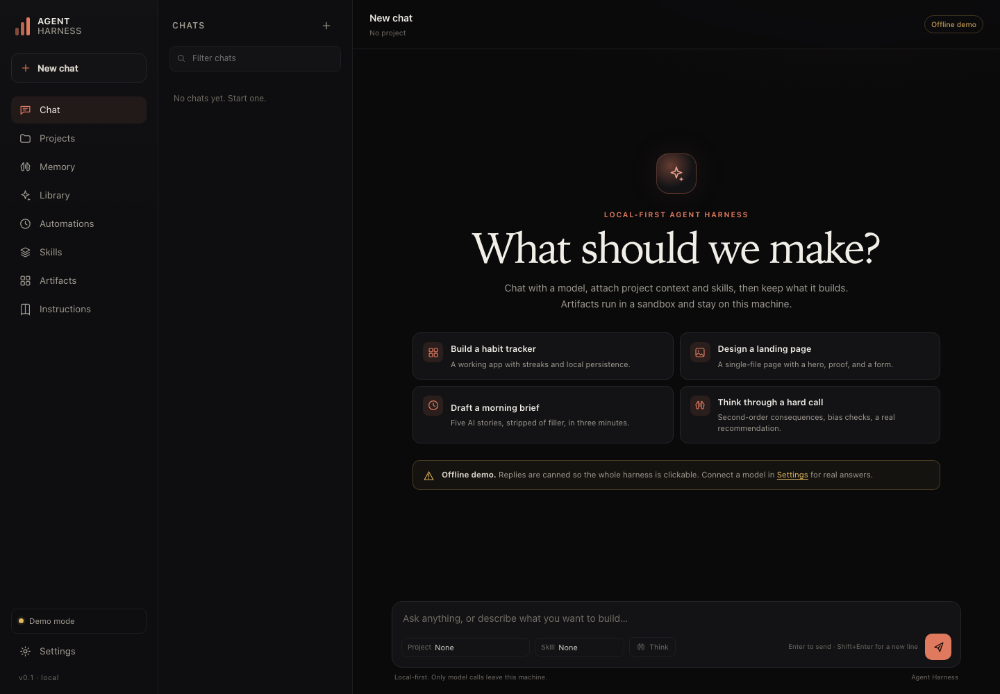

# Agent Harness MVP

A local-first agent harness that implements the useful half of the Spanish
guide about Claude's advanced features: **projects, memory, artifacts, skills,
scheduled tasks, role prompts, and workspace instructions**.

It is a single Node.js app with **zero runtime dependencies**. It does not
install anything globally, does not need a build step, and boots in demo mode
with no API key so every screen is usable offline.

> **Demo mode is canned.** Without a model key, replies are pre-written
> demonstrations, not real answers. The habit tracker and landing page artifacts
> are complete working apps. Connect a provider in Settings to use a real model.



---

## Quick start

Requirements: **Node.js 22.13 or newer** (the app uses the built-in
`node:sqlite` module). Tested on Node 26.

```bash
cd "Agent Harness"
npm start
```

Open <http://127.0.0.1:4400>.

There is no `npm install` step. `npm start` only runs `node server/index.mjs`.

```bash
npm test          # 38 tests, no browser required
PORT=4401 npm start
```

The first run creates `data/` with a SQLite database and one example project.
Stop the server with `Ctrl+C`.

### First five minutes

1. Open **Settings**, choose a provider, and save a key. Or stay in demo mode.
2. Open **Projects → Content studio (example)** and read the fixed instructions.
3. Open **Chat → Build a habit tracker** and press send. Open the artifact.
4. Add something on **Memory**, then start a new chat and ask a question.
5. Open **Automations → New task** and create a weekday brief. Press **Run now**.

---

## What is included

| Guide item | Status | What the MVP does |
| --- | --- | --- |
| 1. Projects | Included | Named projects with fixed instructions and text reference documents, injected into every chat in the project. |
| 2. Artifacts | Included | The model returns self-contained HTML/SVG; the app previews it in a sandbox, saves it, supports download and a standalone preview page. `localStorage` is shimmed so app state survives reloads. |
| 3. Extended thinking | Included where the provider supports it | A **Think** toggle. Anthropic gets native extended thinking; OpenAI o-series/GPT-5 models get `reasoning_effort`; reasoning is shown in a collapsible block when the provider exposes it. |
| 4. Memory | Included | Manual memory plus automatic `<memory>` tags. Injected into every conversation; can be disabled in Settings. |
| 5–9. Role prompts | Included | The article's roles translated into English and stored in the **Library**, with placeholders ready to fill in. |
| 10. Claude in Chrome | **Excluded** | Needs a browser extension, global installation, and broad page access. Out of scope for a local MVP. |
| 11. Files on your computer | **Partial** | You can attach text/Markdown/CSV/JSON to a project. There is no arbitrary disk access or PDF/Word parsing. |
| 12. Scheduled tasks | Included | Daily, weekday, hourly, and interval schedules. Runs the prompt, saves output in `data/outputs/`, keeps run history. Runs only while the server is up. |
| 13. Skills | Included | Markdown instruction packs in `skills/<id>/SKILL.md`, with a UI editor. Attach one to a chat or a task. |
| 14. CLAUDE.md | Included as `AGENTS.md` | Editable in **Instructions**, read at the start of every conversation. Falls back to `CLAUDE.md` if `AGENTS.md` is absent. |
| 15. Claude Code | **Excluded** | A shell-based coding agent needs command execution, sandboxes, approvals, and a diff/test loop. That is a separate product, not a side feature. |
| 16. Design | Included | Design work is an artifact: the Library includes a landing-page brief and the `landing-page` skill enforces a responsive single-file page. |
| 17. Prompt caching | Included for Anthropic | The Anthropic adapter marks stable system blocks with `cache_control: {"type":"ephemeral"}`. OpenAI-compatible providers manage caching themselves. There is no UI because it is an API-level optimization. |
| 18. Video editing | **Excluded** | Requires ffmpeg or a media pipeline. Not core to a harness MVP, and it would add a global binary dependency. |
| 19. Connectors | **Excluded** | Gmail, Calendar, Drive, and Notion need OAuth apps, scopes, token storage, and network access. Too much surface for the MVP. |
| 20. Photo to spreadsheet | **Excluded** | Needs image upload and a vision-capable model. The Library still includes a receipt prompt that works with pasted text. |

A longer version of this table, with the reasoning behind each choice, is in
[docs/FEATURE-MAP.md](docs/FEATURE-MAP.md).

---

## Connect a model

Open **Settings** and pick one of:

- **Demo**: no calls, no key.
- **OpenAI-compatible**: OpenAI, DeepSeek, OpenRouter, Groq, LM Studio, or
  Ollama's `/v1` endpoint.
- **Anthropic**: native Messages API, with extended thinking and prompt caching.
- **Auto**: use a saved key, then an environment key, then demo.

The base URL, model, and key are editable. **Save & test connection** makes a
small real request and reports the model and latency. Keys are saved to
`data/config.json` with mode `0600` and are never returned to the browser.

### Environment variables

Create a local `.env` (gitignored) or export variables. `.env` is loaded
automatically at startup.

| Variable | Purpose |
| --- | --- |
| `HARNESS_PROVIDER` | `auto`, `demo`, `openai`, or `anthropic` |
| `OPENAI_API_KEY` | Key for any OpenAI-compatible endpoint |
| `OPENAI_BASE_URL` | Defaults to `https://api.openai.com/v1` |
| `OPENAI_MODEL` | Defaults to `gpt-4o-mini` |
| `DEEPSEEK_API_KEY` | Convenience preset: auto mode uses DeepSeek |
| `ANTHROPIC_API_KEY` | Anthropic key |
| `ANTHROPIC_MODEL` | Defaults to `claude-sonnet-4-5` |
| `PORT` | Defaults to `4400` |
| `HOST` | Defaults to `127.0.0.1`; keep it local |
| `HARNESS_DATA_DIR` | Alternative data directory, relative to the repo root |

Environment keys are used only when no saved key exists. Base URLs and models
from the environment take precedence over saved values.

For a local model:

```dotenv
HARNESS_PROVIDER=openai
OPENAI_BASE_URL=http://127.0.0.1:11434/v1
OPENAI_MODEL=qwen2.5:7b
```

No key is required for localhost endpoints.

### Anthropic notes

- Extended thinking is requested with a 4,096-token budget and an 8,192-token
  output cap. The selected model must support thinking.
- Stable system blocks are cached for five minutes. The first call writes the
  cache; later calls in the window reuse it. Cache hits are reported in the
  stored message metadata when the provider returns them.
- If a model rejects thinking, switch **Think** off or choose a compatible
  model.

---

## Using the harness

### Chat

- **Project** and **Skill** selects attach context to the current chat.
- **Think** toggles extended reasoning for that conversation.
- The first message becomes the chat title.
- Reasoning appears in a collapsible block above the answer.
- Copy buttons exist for replies and code blocks.

### Projects

Project instructions and document text are injected before the conversation.
Documents are plain text in the MVP (`.md`, `.txt`, `.csv`, `.json`, `.html`).
Large documents are truncated at 6,000 characters each and 18,000 characters
total. Open **Instructions → Preview context** to see exactly what the model
receives.

### Memory

Add a durable fact manually, or say something like "remember that my name is
Aaron". The model is instructed to emit `<memory category="person">…</memory>`;
the app strips the tag, saves it, and shows a toast. Memory is capped at 8,000
characters of injected context and can be disabled without deleting anything.

### Artifacts

Ask for an app, dashboard, landing page, or diagram. The model returns:

````text
```html artifact="Short title"
<!doctype html>...
```
````

The app extracts the block, saves it, and shows a preview card. Artifacts run in
a sandboxed iframe with:

- no same-origin access to the harness UI,
- a CSP that blocks network requests, external scripts, and external fonts,
- a bridge that replaces `localStorage` with a per-artifact store backed by the
  browser's localStorage.

Artifact runtime state is therefore per-browser, not in SQLite. Downloading the
HTML does not include saved state. The "New tab" page (`/artifact/<id>`) is a
local preview, not a public share link.

### Automations

- Schedules use the server's local timezone.
- The process must be running.
- If a run is missed while the server is off, it runs once when the server
  starts again.
- Output is written to `data/outputs/<task>-<timestamp>.md` and kept in the
  run history.
- Tasks can use a project and a skill.

### Skills

Skills are plain Markdown files with a small frontmatter block:

```markdown
---
name: Meeting notes
description: Turn notes into decisions and owners.
---

Instructions here.
```

Use the **Skills** page to create, edit, view, or delete them. The bundled
skills are `ai-news-brief`, `landing-page`, `meeting-notes`, and
`newsletter-voice`.

### Instructions

`AGENTS.md` is the workspace-level instruction file. It is read on every chat,
alongside the base rules, project context, memory, and the selected skill.

### Library

The English translations of the article's prompts. "Use in chat" creates a new
conversation and loads the prompt into the composer, so you can fill the
brackets before sending. "Copy" puts the raw prompt on the clipboard.

### Export

The Settings page exports a JSON snapshot of projects, documents, conversations,
messages, memory, artifacts, tasks, and task runs. It does **not** include
`data/config.json` (keys) or the browser-local artifact state.

---

## Architecture

```text
server/
  index.mjs       process entry, .env loading, graceful shutdown
  app.mjs         HTTP routing, SSE chat stream, task runner, static files
  store.mjs       SQLite schema and queries (node:sqlite)
  context.mjs     system prompt and history assembly
  llm.mjs         demo / OpenAI-compatible / Anthropic streaming adapters
  demo.mjs        canned offline responses
  scheduler.mjs   schedule math and the local tick loop
  skills.mjs      SKILL.md parsing and CRUD
  settings.mjs    provider resolution, config persistence
  text.mjs        artifact and memory tag extraction
  fixtures/       demo artifact HTML
public/
  index.html      app shell
  app.js          hash-routed UI
  artifact.html   standalone artifact preview
  js/             API client, Markdown renderer, icons, artifact sandbox bridge
prompts/roles.json
skills/<id>/SKILL.md
data/             generated: harness.db, config.json, outputs/
tests/            38 unit and integration tests
```

Request flow for a chat:

1. Save the user message.
2. Build context: base rules, `AGENTS.md`, project instructions/documents,
   memory, skill, capability limits, last 30 messages.
3. Stream from the provider over SSE.
4. Extract artifact and memory blocks.
5. Save the assistant message, artifacts, memory, and title.
6. Return the saved conversation to the UI.

The server binds to `127.0.0.1`, checks the `Host` header, and serves no CORS
headers. There is no account system. Do not expose the port to a network.

---

## Security notes

- **API keys** live in `data/config.json` in plaintext with `0600` permissions.
  This is a local, single-user tool. Use environment variables if you prefer
  not to have keys on disk.
- **Model context leaves the machine** to the provider you configure. Project
  documents, memory, and conversation history are included.
- **Artifacts are untrusted model output.** They are sandboxed and
  network-blocked, but they are still code. Do not paste secrets into an
  artifact.
- **No shell.** There is no command execution or browser control. The only
  writes are the data directory, `skills/`, and `AGENTS.md`.
- **No auth.** Anyone who can reach `127.0.0.1:4400` can use the harness. Keep it
  local.

---

## Known limits

- Demo responses are canned and intentionally not live information.
- No PDF, Word, image, audio, or video ingestion.
- No tool calling or code execution loop.
- No public sharing, multi-user accounts, or hosted deployment.
- Scheduled tasks are not a daemon; they run only while `npm start` is alive.
- Structured memory extraction depends on the model emitting `<memory>` tags.
- Anthropic thinking and prompt caching depend on the selected model.
- Artifact state is stored in the browser, not in the database.
- One process and one SQLite database; large histories are truncated by
  character budget rather than tokenized.

---

## Reset

Stop the server, then delete the generated data directory:

```bash
rm -rf data
```

The next start seeds a fresh database and the example project. Skills and
`AGENTS.md` are source files, not database rows, so they are unaffected.

---

## Tests

```bash
npm test
```

The suite covers:

- schedule math and the scheduler tick
- artifact and memory extraction
- system-context assembly and history trimming
- Markdown escaping, tables, lists, and link sanitization
- provider resolution
- OpenAI and Anthropic SSE parsing with a mocked `fetch`
- the full HTTP API: projects, streaming chat, artifacts, memory, tasks,
  settings, skills, export, and static routes

The browser UI was additionally smoke-tested with Playwright: chat, artifact
preview and persistence, project selection, memory, skills, task creation and
runs, settings, and mobile layouts.
